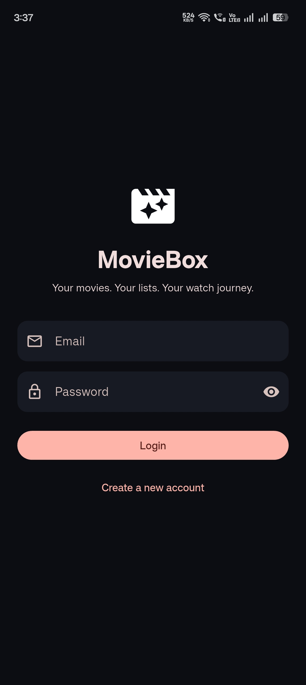
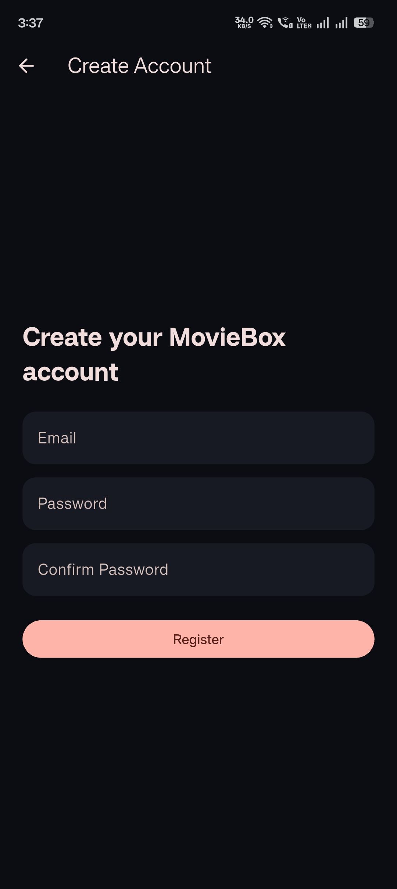
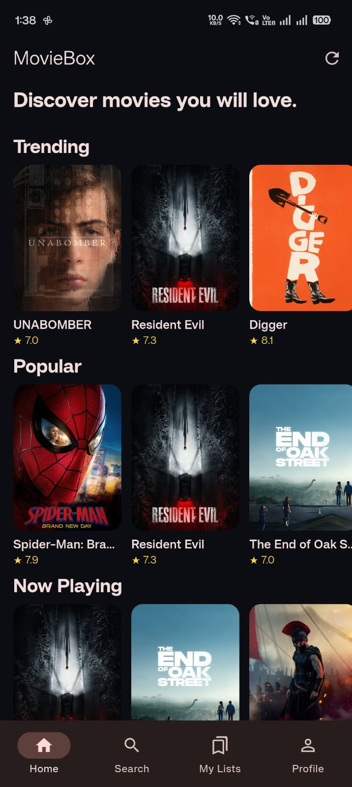
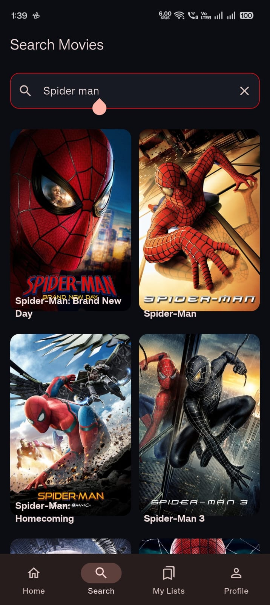
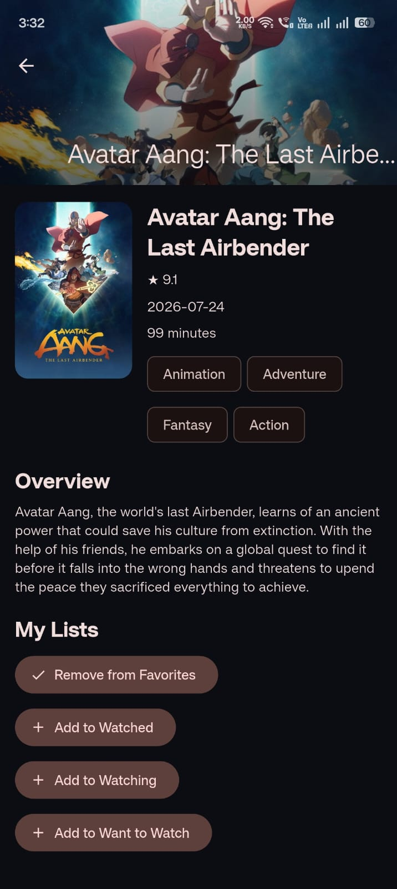
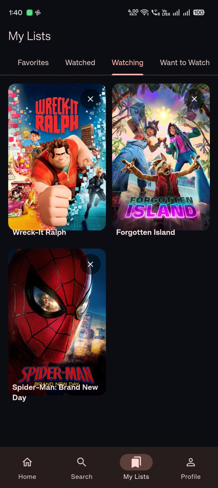
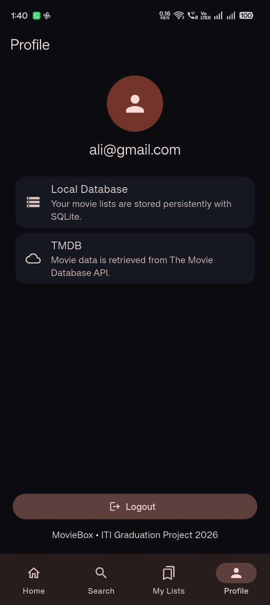

# MovieBox

MovieBox is a Flutter movie discovery app built for the ITI Summer Internship 2026 Flutter Track graduation project. It uses TMDB for movie data, Firebase Authentication for accounts, Provider for app state, and SQLite for persistent movie lists.

## Screenshots

| Login | Registration |
| --- | --- |
|  |  |

| Home | Search |
| --- | --- |
|  |  |

| Movie details | Favorites |
| --- | --- |
|  |  |

| Profile |
| --- |
|  |

## Features

- Register, sign in, and sign out with Firebase email/password authentication.
- Browse Trending, Popular, Now Playing, Top Rated, and Upcoming movies from TMDB.
- View movie details and search movies with a short input debounce.
- Add and remove movies from Favorites, Watched, Watching, and Want to Watch.
- Persist each list in SQLite, associated locally with the signed-in Firebase user.
- Show loading, error, retry, and empty states in movie and list flows.

## Technologies

- Flutter and Dart
- Provider (`ChangeNotifier`) for state management
- TMDB REST API using `http`
- Firebase Core and Firebase Authentication
- SQLite using `sqflite_common_ffi`

## Architecture

The app uses a lightweight, Provider-based MVC style. This keeps presentation, app logic, data access, and data models in separate parts of the project:

- **Screens and widgets** in `lib/screens/` and `lib/widgets/` render the interface and forward user actions.
- **Providers** in `lib/providers/` hold presentation state, coordinate asynchronous work, and notify listening widgets.
- **Services** in `lib/services/` handle TMDB requests, Firebase Authentication, and SQLite operations.
- **Models** in `lib/models/` parse movie API responses and represent movie list types.
- **App setup** in `lib/main.dart` initializes Firebase and registers shared services and providers.

For example, a screen calls a provider, the provider uses a service to fetch or store data, and the provider then notifies the screen when the result or state changes. API and database code stays outside the UI layer.

## State management

Provider is used through `ChangeNotifier`. `AuthProvider` observes Firebase's authentication state and exposes the current user, loading state, and user-facing errors. Movie providers manage home sections, movie details, search results, and saved lists, including loading and error states. Widgets use `Consumer` or `context.watch` to rebuild when relevant state changes.

## TMDB API

`TmdbService` makes HTTP requests to TMDB for trending, popular, now-playing, top-rated, upcoming, detail, and search data. The `Movie` model parses the returned JSON. Search input is debounced to avoid issuing a request for every keystroke. Configure a TMDB API key as described below; the example file deliberately contains a placeholder.

## Authentication

`AuthService` wraps Firebase email/password registration, login, logout, and authentication-state changes. `AuthProvider` translates common Firebase errors into messages for the UI. The project includes generated client configuration in `lib/firebase_options.dart`; authentication still requires a Firebase project with Email/Password sign-in enabled and the correct app configuration for the target platform.

## Database and movie lists

The project uses local SQLite, not Cloud Firestore. The `movie_lists` table stores a movie's data, the Firebase user ID, and its list type. A unique constraint on user ID, movie ID, and list type prevents duplicate entries. The four required lists (Favorites, Watched, Watching, Want to Watch) can be loaded, added to, and removed from. Data persists on the device across app restarts, but it does not sync between devices.

## Project structure

```text
lib/
  main.dart                 Firebase and Provider setup
  app_constants.dart        App constants and TMDB key loading
  app_theme.dart            Application theme
  firebase_options.dart     Generated Firebase client configuration
  models/                   Movie and movie-list types
  providers/                Authentication and movie state
  screens/                  Login, registration, home, search, lists, details, profile
  services/                 TMDB, Firebase Authentication, and SQLite
  widgets/                  Reusable movie UI
assets/config/
  api.env.example           TMDB key template
screenshots/                README screenshots
```

## Setup and run

### Requirements

- Flutter SDK compatible with the Dart constraint in `pubspec.yaml`
- A TMDB API key
- A Firebase project with Email/Password sign-in enabled
- Android Studio / Android SDK or Xcode, depending on the target platform

### Configure

1. Clone the repository and change into the project directory.
2. Copy `assets/config/api.env.example` to `assets/config/api.env` and replace `YOUR_TMDB_API_KEY` with your TMDB key. The local `api.env` file is ignored by Git.
3. Configure Firebase for the platforms you intend to run. Review `lib/firebase_options.dart` and regenerate it with FlutterFire CLI if you use a different Firebase project. Ensure the Firebase app identifiers and any required native Firebase configuration files match that project.
4. Fetch packages and run the app:

   ```sh
   flutter pub get
   flutter run
   ```

## Known limitations

- Saved lists are local to the current device and do not synchronize across devices.
- Live movie requests need a valid TMDB API key and an internet connection.
- Authentication needs a correctly configured Firebase project and enabled Email/Password provider.
- Figma is optional in the ITI specification; no Figma design link is included.

## ITI submission coverage

| Specification area | Project implementation |
| --- | --- |
| Flutter app and navigation | Flutter screens for authentication, browsing, search, details, lists, and profile |
| TMDB integration | `TmdbService`, `Movie` model, categories, details, and search |
| Firebase Authentication | Email/password registration, login, logout, auth state, validation, and error messages |
| Architecture | Provider-based MVC style with separate screens, providers, services, and models |
| State management | Provider and `ChangeNotifier` for auth and movie state |
| Four persistent lists | Favorites, Watched, Watching, and Want to Watch in SQLite |
| Documentation and screenshots | This README and the `screenshots/` directory |
| Figma | Optional; not provided |

## Before submission

- Configure valid TMDB and Firebase settings for the target environment.
- Run the app on the intended device and verify registration, login, logout, movie loading, search, details, all four list actions, and persistence after restart.
- Confirm the GitHub repository is accessible to the evaluator and that no secrets or private keys have been committed.
- Be ready to explain the architecture, state flow, API integration, Firebase setup, and SQLite implementation.
